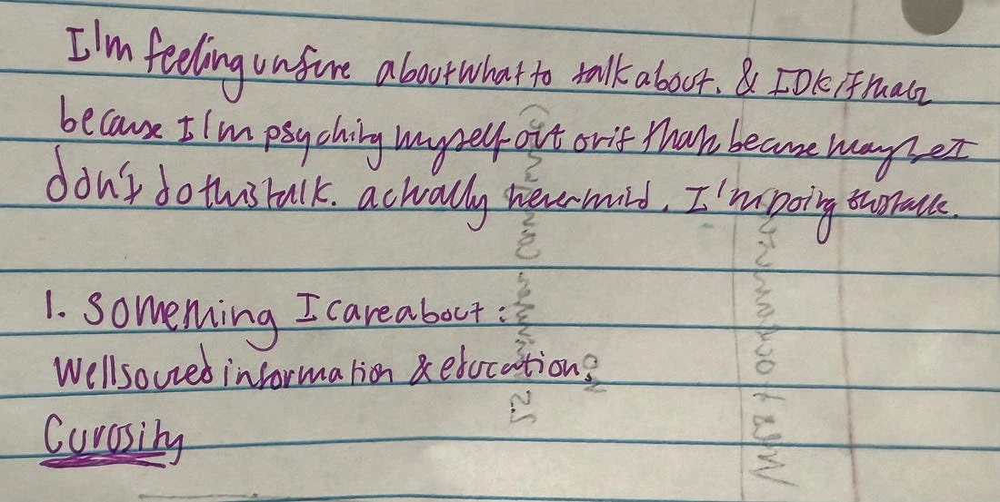
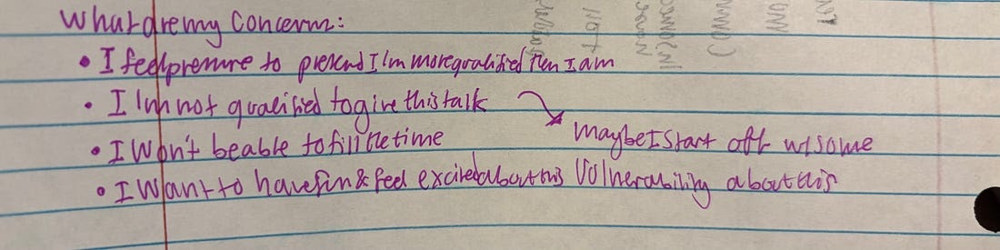
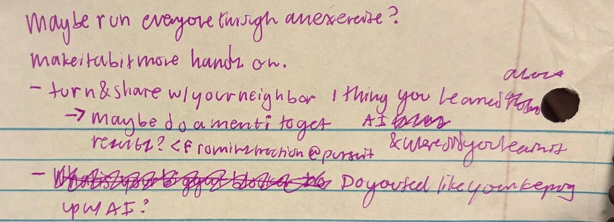
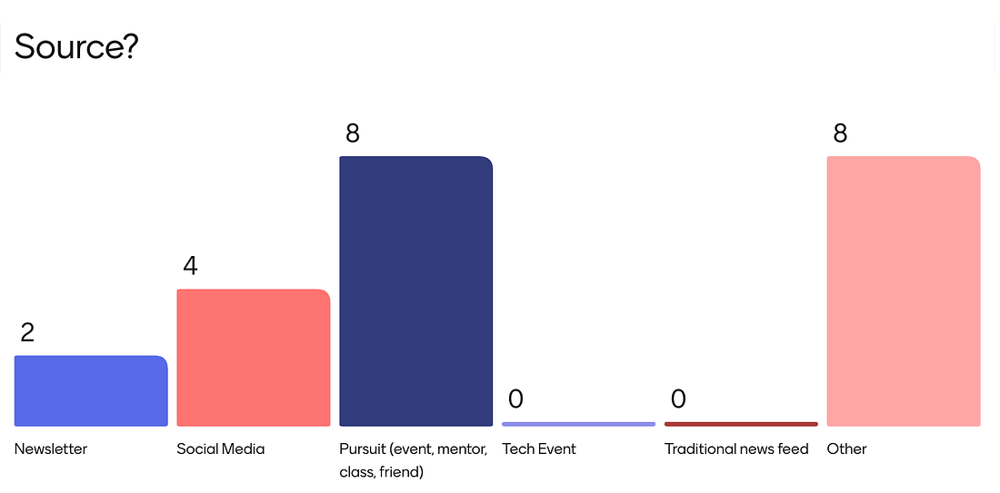

(This was originally presented at [Pursuit](https://www.pursuit.org/ai-native-program) on June 30th, 2026. [Slide deck here](https://www.menti.com/al6abqopwkwf). Skip to the end if you want the narrative. Also, it’s not in a “perfect” state, and I need to be fine with that and just publish it. BTW claude only helped clean up the spelling & grammar mistakes.)

## Why do you want to stay current with AI news?

A plan flows a lot easier when there is a clear purpose. Knowing what is important to you is the first step to curation. Curation also implies control. Your AI news feed serves you. In no way do you serve an algorithm or the media cycle. So what is your purpose when you read a newsletter, attend an event, engage with content on LinkedIn, or scroll the front page of Hacker News?

You are enrolled in Pursuit, which has the following purpose:

> Pursuit is equipping you with AI skills, community, and network to get hired and thrive in an AI-first world.

This mission statement connects with three primary pillars: AI skills, community, and network. And all this is not just to get hired (’cause you are so much more than a job), but also to thrive. This is for you. This is for your learning journey.

As we check in with your current news feed and discover what should be improved and changed, make sure it’s aligned with your purpose. Adopting Pursuit’s as your own works. Other ideas might surface as we walk through some exercises.

To assess your AI news feed, think back to one thing you learned this week about the AI world that engaged you and piqued your curiosity. Maybe you added your two cents to a tweet. Maybe it’s a technical project that uses or supports AI. Maybe a geopolitical event directly related to AI technologies.

Now think about your source for this piece of news. Did you find it in a newsletter? Social media? Pursuit (event, mentor, class, friend)? Tech event? Traditional news feed? Something else?

This is just one example, but curiosity is a great signal. Your news feed should feed and build your curiosity. So how is your feed doing? What technical skills are you learning via your AI news feed? Whose content are you engaging with? Are you producing content that builds communities and networks around you?

On a scale of 1–5, how much do you agree with the following:

- My AI feed serves my purposes
- I feel well equipped to improve how I stay current in AI
- I often come across new ideas/tools/projects that get me excited/curious about AI
- I enjoy talking with other people about AI-related topics I’m learning
- I am able to balance absorbing and then implementing what I learn

*Pursuit’s Responses*

## My experience

In November I joined [Plastic Labs](https://plasticlabs.ai/) to support building [Honcho](https://honcho.dev/), AI memory infrastructure. Previously I worked at [Leidos](https://careers.leidos.com/pages/leidos-office-of-technology) on their internal AI offerings. At Leidos I had a lot of flexibility in what I worked on and would set aside time in my workday to read papers, browse Hacker News, and try out new GitHub repos.

In this new role at Plastic Labs I was qualified, but the environment felt drastically different. I was jumping from a company with 47,000 employees to 8. My coworkers were sharing sources and talking about AI labs in ways I had never thought about. The quantity and speed of information was much faster and denser.

I also learned about Twitter as an AI news source. I created my first Twitter account, and one of my responsibilities involved posting on Twitter every day. I quickly observed some differences between that platform and other news sources.

It didn’t take long to feel the anxiety and pressure to be “better at keeping up.” A pretty vague mission statement. I felt overwhelmed by the quantity of information, ideas, and headlines holding my attention.

Now that was November. Eight months later, things are not solved. I don’t have my AI news feed “figured out.” But things are better. I feel less overwhelmed, and more of my attention is spent on things that spark my curiosity (vs. drain me). I don’t serve the algorithm, and I am in a better place for balancing the tension between absorbing and implementing the things I learn.

## A couple things I’ve learned

Things are not perfect, but this experience taught me a lot. I want to share a couple of resources and ideas that I’ve learned.

Sources are really important. Who wrote this? What have they been building? Why do they care? What are their incentives? AI news can easily disintegrate into complexity theater, and a lot of claims are made that have no validation. If my curiosity is piqued (which, if my information sources are structured correctly, it should be), I’ll build and test and prove out the idea myself.

Some ideas for sources: this list is certainly a lot longer than my personal feed, but I wanted to talk through some of the options and possibilities.

### Sites

- [Hacker News](https://news.ycombinator.com/) — broad tech
- lobste.rs — smaller, more technical
- [GitHub Trending](https://github.com/trending)
- [Hugging Face](https://huggingface.co/) — what’s being built ([Daily Papers](https://huggingface.co/papers) for what’s published)
- [r/LocalLLaMA](https://www.reddit.com/r/LocalLLaMA/) — open models, quantization, local inference
- [alphaXiv](https://www.alphaxiv.org/) — arXiv papers with discussion
- [Papers with Code](https://paperswithcode.com/)
- Lab blogs — primary source, earliest: [Anthropic](https://www.anthropic.com/news), [OpenAI](https://openai.com/news/), [Google DeepMind](https://deepmind.google/discover/blog/), [Mistral](https://mistral.ai/news), [Ai2](https://allenai.org/blog)
- Package release feeds — dependency news as a feed: [npm](https://www.npmjs.com/), [PyPI](https://pypi.org/), crates.io
- RSS reader

### Newsletters

- [Every](https://every.to/) — essays, business/product angle
- [TLDR AI](https://tldr.tech/ai) — daily, fast scan of news and papers
- [Lenny’s Newsletter](https://www.lennysnewsletter.com/) — product, not very technical
- [Ben’s Bites](https://www.bensbites.com/) — builder/business, now leans AI investing
- [Latent Space](https://www.latent.space/) — AI engineering: agents, evals, inference
- [Interconnects](https://www.interconnects.ai/) — RL, open models, frontier labs (Nathan Lambert)
- [The Batch](https://www.deeplearning.ai/the-batch/) — weekly research framing (Andrew Ng)

## Simplifying

The sources listed here are not comprehensive and are just meant to spark some ideas. In no way should your takeaway from this be “I need to add more.” In fact, I expect most of the focus to be on simplifying. We live in a very information-dense environment, but we are finite, attention-limited beings. You can only process a small sliver of that information, and only some of it will be relevant to you.

To be sure of this, conduct regular check-ins with yourself and see what needs to be simplified.

With this in mind, I will leave you with one final question: What is one action you can take this week to improve your AI news feed?

## What the process was like (for those curious)

One of the first post-presentation questions was: “Why did you choose this topic? It feels helpful but also very specific.” To answer, I found I needed to start at the beginning.

Back sometime in April, I did a quick, spur-of-the-moment presentation for my mentee’s cohort on open source contributions. I loved it. The builders paid close attention and asked lots of great questions. I felt well suited to deliver valuable content because of my recent work in OSS. Because of the short notice, the pressure to “perform” felt low.

Afterward, I talked with their instructor and offered to do it again on the same topic or something else. After a bit of back-and-forth, we found a date three months later, and I decided to talk about something new to stretch myself. With my mentee at the time, I wanted to discuss AI news and new projects. I found this to be a valuable transfer of knowledge and felt like there might be a larger opportunity across Pursuit around how to keep up with AI news. Thus, the topic was born.

In the back of my head, I knew I’d probably regret this later. However, I felt confident that this would stretch me and be a good experience. I also felt confident I could talk about this topic. Not because I was the most up-to-date person, but because it’s something I’ve tried to be intentional about.

I had ample time to prepare, but most of the prep happened the week before, specifically the Saturday before. Having ample time seemed to impede my ability to focus. Additionally, they asked me to talk for 30–40 minutes, which felt significantly longer than the 10 I had spoken before.

And sure enough, the questions started to fill my brain. How did I even think I was qualified to give this talk? I am far from the most “up-to-date” news girl. I often stay up to date based on what my coworkers talk about! I feel allergic to social media & “traditional news feeds.” I’m not even 25! Why did I truly think this was a good idea?

So meet Abigail the Saturday before. Stressed. At a loss for what to even talk about. Seriously questioning her choice to volunteer for this opportunity. I essentially spent the whole day procrastinating on the presentation. I felt blocked.

So after doing all of my favorite “productive” procrastination tasks, I had only about an hour to finish prepping. So I started by writing down why I felt so blocked and stuck. Just the act of writing this down helped immensely.

*I’m feeling unsure about what to talk about, & IDK if that’s because I’m psyching myself out or if that’s because maybe I don’t do this talk. Actually, never mind. I’m doing this talk.*

*What are my concerns? I feel pressure to pretend I’m more qualified than I am. I’m not qualified to give this talk (maybe start off w/ some vulnerability about this). I won’t be able to fill the time. I want to have fun & feel excited about this.*

*Maybe run everyone through an exercise? Make it a bit more hands-on. Turn & share with your neighbor 1 thing you learned about AI & where you learned it. Maybe do a Menti to get results?*

The ideas that flowed after writing down all of my concerns felt like inspiration from God. I could feel His interest in what I was doing and particularly His love for the people I’d be talking to. This felt comforting and confidence-building.

I didn’t need to talk for 30 minutes; I could make this interactive! I could ask lots of questions and get people involved and engaged with thinking about their AI news feed. Using [Menti](https://www.mentimeter.com/) felt like a great fit. This felt like the right direction, and the ideas I had before meshed nicely with my now unblocked ideas.

I reminded myself I chose to do this and I could make it fun! No one was forcing me. I had total control and flexibility over what I’d talk about and could even do a different topic if I wanted.

I was also reminded of other times I’d talked for extended periods about a topic I did not feel any expertise in: Sunday School! In that classroom environment, I try my best to make it interactive, engaging, and fun. I talk about my experience and invite people to share theirs. I also involve God in the process. I realized there was no reason why this presentation opportunity should be any different.

Some things I knew:

- The actual mechanics of my “AI news feed” are nothing special. It’s not anything to write home about.

- I am not “trying” to keep up. My purpose is to learn & stay educated. I chose to dig into a couple of topics and not everything, intentionally. As such, I wanted everyone to learn and re-engage with their “purpose” for keeping up with AI.

- My AI news feed is not static, but evolving. It’s changed a lot, even within the last year.

- Curiosity is really important. I wanted to encourage curiosity and discourage feeling overwhelmed. I wanted to make things actionable and encourage setting goals.

- I wanted to have fun.

## Post-presentation

The audience was different from the first time I talked in front of a cohort at Pursuit. Maybe because of the physical format of the room, people seemed easily disengaged and more interested in their laptops. This cohort was also a level before the one I talked with previously, and I did observe a difference in their skill set and understanding.

People really enjoyed the Menti and engaged with it, but there were probably a few too many questions at the beginning. I think they also liked the ability to follow along with the slides and click on sources, etc.

I got quite a few questions afterwards as well, which was fun. They covered a variety of topics: AI psychosis, getting Chat to speak in hood speak, whether to use Obsidian or Notion, etc.

I was surprised by the responses to “What have you learned about AI this week?” I expected the sources to fall under the buckets below. But the “other” bucket ended up being mostly entries from people who learned about AI from talking with AI.

I really enjoyed the process of teaching and presenting to a group. I found it fun! It felt similar to when I teach Sunday School at church. I also appreciated the accountability and purpose this task gave me. I had a deadline that was self-imposed but not self-enforced, and I would be held accountable.

So, in conclusion, I’m doing another presentation at Pursuit in October on understanding agent harnesses, hehe.
